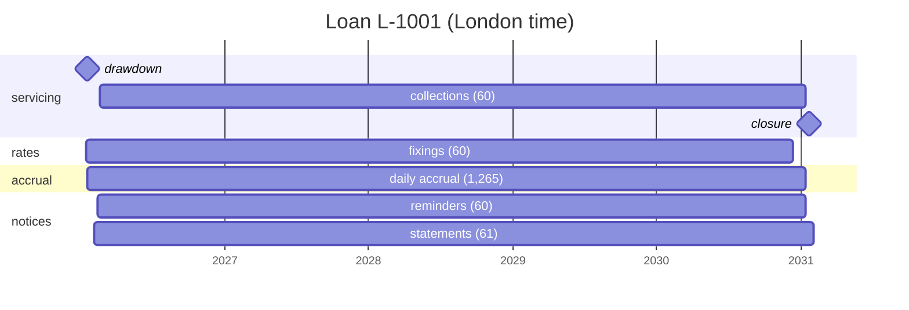

# A loan's life in schedule documents

One loan, from setup to closure, written as the schedule documents an
application would register with tempo. It puts the
[schedule document](schedule-document.md) design together: shared
definitions, per-loan instances, one-off dates, and a lifetime event as a
new version.

Every YAML block on this page is read by
[`crates/tkone-calendar/tests/loan_lifecycle.rs`](../crates/tkone-calendar/tests/loan_lifecycle.rs),
which builds each document on the built-in `GBLO` calendar and checks every
date quoted here.

- [The loan](#the-loan)
- [Definitions and instances](#definitions-and-instances)
- [The definitions](#the-definitions)
- [The instances](#the-instances)
- [The whole life](#the-whole-life)
- [A lifetime event: early repayment](#a-lifetime-event-early-repayment)
- [Who does what](#who-does-what)
- [Caveats](#caveats)

## The loan

| | |
|---|---|
| Loan | L-1001: £120,000 over 5 years, floating rate, repaid monthly |
| Set up | Mon 5 Jan 2026: the application registers everything |
| Drawdown | Thu 15 Jan 2026, 12:00 London |
| Repayments | the 15th of each month at 12:00, Modified Following: 60, the last on Wed 15 Jan 2031 |
| Rate | fixed at 11:00, two business days before each period starts |
| Closure | Wed 22 Jan 2031: the account is closed, five business days after maturity |

## Definitions and instances

A few **definitions** are shared by every loan and set up once by
operations. Each loan has its own **instances**, registered by the
application when the loan is set up
([D11](schedule-document.md#d11-applications-own-domain-dates-tempo-owns-timing)).
An instance picks slots its definition produces, and nothing else.

```text
 definitions (shared, few)            instances for L-1001 (set once, at setup)
 ─────────────────────────            ─────────────────────────────────────────
 servicing   12:00 business days  ◀── drawdown · collections · closure
 rates       11:00 business days  ◀── fixings
 accrual     18:00 business days  ◀── accrual
 notices     09:00 business days  ◀── reminders · statements
```

A million loans still means four definitions. Tempo indexes each instance by
its next due, so the instances cost a lookup, not a walk.

In each block, the first comment names what tempo would register it as: a
definition, or an instance with its key and its definition. Tempo's
registration API is not designed yet, so that line is a label, not syntax.

## The definitions

```yaml
# definition: servicing
# Money moves at 12:00 on London business days.
version: 1
time_zone: Europe/London
calendar: GBLO
start: 2026-01-01
rules:
  - { id: batch, rule: YY-MM-DD~SBT12:00:00 }
```

```yaml
# definition: rates
version: 1
time_zone: Europe/London
calendar: GBLO
start: 2026-01-01
rules:
  - { id: batch, rule: YY-MM-DD~SBT11:00:00 }
```

```yaml
# definition: accrual
version: 1
time_zone: Europe/London
calendar: GBLO
start: 2026-01-01
rules:
  - { id: batch, rule: YY-MM-DD~SBT18:00:00 }
```

```yaml
# definition: notices
version: 1
time_zone: Europe/London
calendar: GBLO
start: 2026-01-01
rules:
  - { id: batch, rule: YY-MM-DD~SBT09:00:00 }
```

## The instances

An instance document has no `time_zone` or `calendar`: its rules are read
with its definition's.

### 1. Drawdown: a one-off

```yaml
# instance: L-1001/drawdown (definition: servicing)
version: 1
start: 2026-01-15T00:00:00
count: 1
rules:
  - rule: 2026-01-15T12:00:00
```

One run: Thu 15 Jan 2026 12:00. A one-off is a rule with a literal date. It
must still be a slot of its definition: a business day, at 12:00.

### 2. Interest accrual: every business day

```yaml
# instance: L-1001/accrual (definition: accrual)
version: 1
start: 2026-01-15T12:00:00
until: 2031-01-15
rules:
  - rule: YY-MM-DD~SBT18:00:00
```

1,265 runs, from Thu 15 Jan 2026 18:00 to Wed 15 Jan 2031 18:00. The start is
the drawdown, so the first run is that evening.

### 3. Collections: the repayments

```yaml
# instance: L-1001/collections (definition: servicing)
version: 1
start: 2026-01-15T12:00:00
until: 2031-01-15
rules:
  - { id: repayment, rule: YY-MM-15~MFT12:00:00 }
exclude:
  dates: [2026-01-15]
```

60 runs: Mon 16 Feb 2026 (the 15th is a Sunday), Mon 16 Mar, Wed 15 Apr, …,
Wed 15 Jan 2031.

The exclusion matters. The start is the drawdown, 15 January at 12:00, and
`YY-MM-15` produces exactly that instant. A start is a slot when a rule
produces it
([D1](schedule-document.md#d1-start-is-an-anchor-not-an-occurrence)), so
without the exclusion the loan would be "repaid" the moment it is lent.

### 4. Rate fixings: two business days before each period

```yaml
# instance: L-1001/fixings (definition: rates)
version: 1
start: 2026-01-01
until: 2030-12-31
rules:
  - rule: YY-MM-15~2PT11:00:00
```

60 runs: Tue 13 Jan 2026 (for the period from the drawdown), Thu 12 Feb,
Thu 12 Mar, Mon 13 Apr, …, Thu 12 Dec 2030 (for the last period).

The start is 1 January, before the drawdown: the first period's rate is fixed
two days before the loan exists.

`~2P` counts back from the 15th, not from the adjusted repayment. Here that
is exact: for all 60 periods of 2026–2030 it gives the same day as counting
back from the repayment, because Modified Following on the 15th only ever
moves forward. On a month-end loan it would be wrong about five months a
year (31 May 2026 is a Sunday: the repayment is Friday 29 May, `~2P` gives
Thursday 28 May, the right day is Wednesday 27 May). Such a loan needs the
[proposed](schedule-document.md#proposed-rules-derived-from-other-rules)
basis form, or a one-off per date computed by the application:

```text
rules:                                    (proposed, not built)
  - { id: boundary, rule: YY-MM-15~MFT12:00:00, basis: true }   # includes the drawdown
  - { id: fixing,   rule: "{boundary}~2PT11:00:00" }
```

### 5. Repayment reminders

```yaml
# instance: L-1001/reminders (definition: notices)
version: 1
start: 2026-01-15T12:00:00
until: 2031-01-15
rules:
  - rule: YY-MM-15~2PT09:00:00
```

60 runs, two business days before each repayment: Thu 12 Feb 2026 (for
Mon 16 Feb), Thu 12 Mar (for Mon 16 Mar), Mon 13 Apr (for Wed 15 Apr), …,
Mon 13 Jan 2031 (for the last). The start drops 13 January, which would be a
reminder for the drawdown. The same caveat about `~2P` applies as for
fixings.

### 6. Statements

```yaml
# instance: L-1001/statements (definition: notices)
version: 1
start: 2026-01-15T12:00:00
until: 2031-02-03
rules:
  - rule: YY-MM-BD#1T09:00:00
```

61 runs, on the first business day of each month: Mon 2 Feb 2026, Mon 2 Mar,
Wed 1 Apr, …, and a final statement on Mon 3 Feb 2031, after maturity.

### 7. Closure: a one-off

```yaml
# instance: L-1001/closure (definition: servicing)
version: 1
start: 2031-01-15T00:00:00
count: 1
rules:
  - rule: 2031-01-22T12:00:00
```

One run: Wed 22 Jan 2031 12:00. The application computes the date at setup
(five business days after maturity) and writes it as a literal.

## The whole life



The first five weeks, as tempo would fire them. These are the moments of a
[timeline](timeline.md) of the instances:

```text
Tue 13 Jan 2026 11:00  fixings      rate for period 1 (15 Jan → 16 Feb)
Thu 15 Jan 2026 12:00  drawdown     £120,000 paid out
Thu 15 Jan 2026 18:00  accrual      first day's interest
Fri 16 Jan 2026 18:00  accrual
         … every London business day at 18:00 …
Mon 02 Feb 2026 09:00  statements
         …
Thu 12 Feb 2026 09:00  reminders    "repayment due Monday 16 February"
Thu 12 Feb 2026 11:00  fixings      rate for period 2 (16 Feb → 16 Mar)
Thu 12 Feb 2026 18:00  accrual
Fri 13 Feb 2026 18:00  accrual
Mon 16 Feb 2026 12:00  collections  closes period 1 (the 15th is a Sunday)
Mon 16 Feb 2026 18:00  accrual      first day at period 2's rate
```

## A lifetime event: early repayment

On Mon 6 Mar 2028 the borrower agrees to repay everything on Fri 10 Mar
2028. The application recomputes the loan's documents and sends new
versions
([D12](schedule-document.md#d12-a-new-version-keeps-the-stored-next-due-unless-it-cant-stand)).

```yaml
# instance: L-1001/collections, version 2 (definition: servicing)
version: 1
start: 2026-01-15T12:00:00
until: 2028-03-10
rules:
  - { id: repayment, rule: YY-MM-15~MFT12:00:00 }
  - { id: early-repayment, rule: 2028-03-10T12:00:00 }
exclude:
  dates: [2026-01-15]
```

```yaml
# instance: L-1001/closure, version 2 (definition: servicing)
version: 1
start: 2028-03-10T00:00:00
count: 1
rules:
  - rule: 2028-03-17T12:00:00
```

The other instances only change their `until`: accrual to `2028-03-10`,
fixings and reminders to `2028-03-09`, statements to `2028-04-03`.

The first `version` field is the document format, always `1`. The document's
own version, 2 here, is tempo's to keep.

What tempo holds on the morning of 6 March, and what D12 does with it:

| Instance | Stored next due | New version | The stored due | Then |
|---|---|---|---|---|
| collections | Wed 15 Mar 12:00 | `until` 10 Mar, a one-off on 10 Mar | recomputed (`recompute_pending`, proposed) | Fri 10 Mar 12:00, then done: 26 collections in all, 25 monthly and the early repayment |
| accrual | Mon 6 Mar 18:00 | `until` 10 Mar | kept | to Fri 10 Mar 18:00, then done |
| fixings | Mon 13 Mar 11:00 | `until` 9 Mar | dropped: the version has ended before it | done |
| reminders | Mon 13 Mar 09:00 | `until` 9 Mar | dropped | done |
| statements | Mon 3 Apr 09:00 | `until` 3 Apr | kept: the final statement | done |
| closure | Wed 22 Jan 2031 12:00 | a one-off on 17 Mar | recomputed | Fri 17 Mar 12:00, then done |

Nothing that has already fired changes, and each run records the version
that computed it.

## Who does what

| The application | Tempo |
|---|---|
| owns the loan's terms and its events | knows nothing about loans |
| writes the instance documents at setup | checks each against its definition (`uncovered`) |
| computes one-off dates (the closure) | stores one next due per instance |
| sends new versions on a lifetime event | keeps, drops or recomputes the stored due (D12) |
| tests it all first in Rust: `Schedule`, `periods`, a [timeline](timeline.md), on [fixed calendars](timeline.md#testing-with-a-timeline) | fires, retries, catches up |

## Caveats

- **`GBLO` is confirmed only to 31 December 2028.** The loan's last two years
  are projected: a holiday declared later moves some of their dates. That is
  D12's "calendar closes the day" case, so tempo records which calendar data
  computed each due.
- **Every slot must be the definition's.** A one-off at 12:30, or on a
  Saturday, is not a slot of `servicing`. `uncovered` reports it when the
  instance is registered, instead of when it is due.
- **The fixings and reminders are exact only because the dates are
  mid-month.** See [fixings](#4-rate-fixings-two-business-days-before-each-period).
- **`recompute_pending` is proposed**, as part of D12, and so is tempo's
  registration API. Everything else on this page works with today's
  `ScheduleDoc`.
