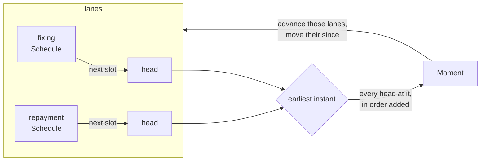
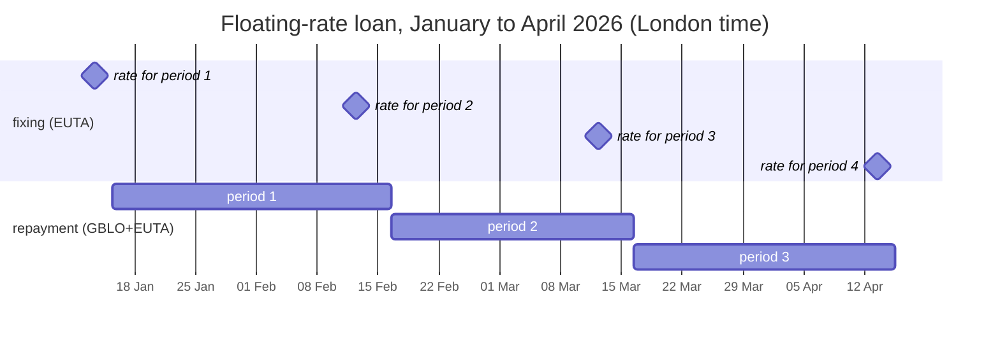
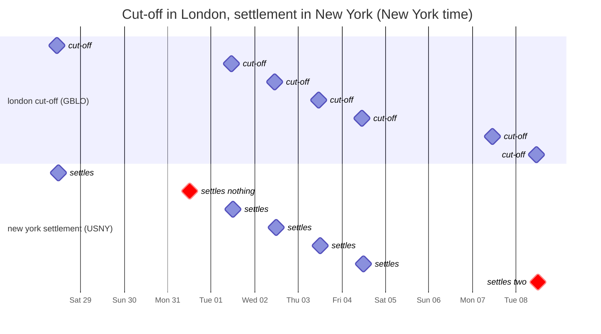

# Timelines

A **timeline** reads several schedules as one: every slot of every schedule, in
time order, grouped by the instant it happens at. It answers the question a
single schedule can't: *what happens next, across everything I run, and in
what order?*

- [Why a timeline](#why-a-timeline)
- [The model](#the-model)
- [How it works](#how-it-works)
- [Example 1: a floating-rate loan](#example-1-a-floating-rate-loan)
- [Example 2: a savings account](#example-2-a-savings-account)
- [Example 3: cross-border payments](#example-3-cross-border-payments)
- [Testing with a timeline](#testing-with-a-timeline)
- [Other uses](#other-uses)
- [Limits](#limits)

Every date and time on this page is checked by
[`crates/tkone-calendar/tests/timeline.rs`](../crates/tkone-calendar/tests/timeline.rs),
on the built-in calendars' confirmed 2026 data.

## Why a timeline

One [`Schedule`](schedule-document.md) already merges its own rules into one
stream of slots. That works when the rules share everything around them: one
start, one time zone, one calendar. Real processes rarely do:

- A loan's **rate** is fixed on the rate's calendar, in Brussels; its
  **repayments** follow the borrower's calendar, in London.
- An account **accrues** every business day, **capitalises** at the month
  end, and sends a **statement** on the first business day. Each is its own
  schedule, but they meet on the same days.
- A payment is **cut off** in London and **settled** in New York, each on its
  own holidays.

Each of these is a schedule of its own. What a test or a simulation needs is
all of them in order, with what coincides kept together. That stream is a
timeline.

## The model

```text
               lanes (one per schedule, under a key)

  fixing     ──●─────────────────●─────────────────────●─────────────▶
  repayment  ────────────────────────●─────────────────────●─────────▶
               │                 │   │                 │   │
  moments    ──●─────────────────●───●─────────────────●───●─────────▶ time
```

| Term | What it is |
|---|---|
| **Lane** | One schedule, added under a **key** of your choosing (`"fixing"`, an enum, a leg id). Keys are unique in a timeline. |
| **Moment** | One instant, with every lane that has a slot at it. Moments strictly increase. |
| **Entry** | One lane's slot in a moment: its `key`, the `slot` (observed instant, rule ids, actual times), and `since`. |
| **`since`** | The lane's boundary before this slot: its previous slot, or the schedule's start for the first. `since` to `slot` is the period this entry closes, as `Schedule::periods` gives it. |

### Order within a moment

When lanes coincide, entries come **in the order their schedules were
added**. That order is the processing order, and it is yours to declare: at
a month end, should the day's accrual come before the capitalisation? Add
`accrue` first, and it always does. A plain merge would leave this to
chance, and that is where bugs that appear only "on month ends that fall on a
Friday" come from.

### Identity

An entry is identified by **(key, observed instant)**:

- The key is unique in the timeline, and an observed instant is unique within
  a schedule (rules that land on one instant are one slot,
  [D4](schedule-document.md#d4-slots-are-unique-by-observed-instant)).
- A moment is identified by its instant alone.
- The **actual** (unadjusted) dates are not the identity: several can merge
  into one slot (Saturday's and Sunday's `~NB` dates land on Monday). They are
  kept in `slot.sources`, for audit and for unadjusted accrual.

The observed instant depends on the calendar. If a holiday is declared after
the fact, a repayment moves from the 15th to the 16th and its identity
changes. In a test, that is what you want to see. Anything that stores
entries must deal with it, as tempo does with versions
([D9](schedule-document.md#d9-a-definition-version-change-keeps-the-anchor)).

## How it works

```rust
use tkone_schedule::schedule::Timeline;

let timeline = Timeline::new()
    .add("fixing", fixings)        // Schedule<Calendar>: TARGET, Brussels
    .add("repayment", repayments); // Schedule<Calendar>: London + TARGET, London

let mut moments = timeline.between(from..=to)?;
while let Some(moment) = moments.next()? {
    for entry in &moment.entries {
        match entry.key {
            "fixing" => { /* entry.slot.at: when the rate is fixed */ }
            _ => { /* entry.since ..= entry.slot: the period repaid */ }
        }
    }
}
```



- **Lazy.** Each lane reads one slot ahead. Ten years or a hundred cost the
  same per step.
- **Bounded.** `between(range)` always ends, even for schedules with no end,
  and even when exclusions drop every date.
- **Each schedule keeps its own context:** start, time zone, calendar,
  exclusions, `until` and count. A lane is read from its schedule's start,
  so the first `since` in the range is right.
- **Time zones.** Moments are ordered by instant: 16:00 in London and 11:00 in
  New York are the same moment. A moment's `at` is in the first entry's zone,
  and each slot keeps its own.

## Example 1: a floating-rate loan

A euro loan to a London company, drawn at 12:00 London on Thursday 15 January
2026.

| Lane | Rule | Calendar, zone | Meaning |
|---|---|---|---|
| `fixing` | `YY-MM-15~2PT11:00:00` | `EUTA`, Brussels | the rate is fixed at 11:00, two TARGET business days before the 15th |
| `repayment` | `YY-MM-15~MFT12:00:00` | `GBLO+EUTA`, London | repaid on the 15th, Modified Following on both calendars |

The repayment schedule starts at the drawdown. `YY-MM-15` would make the
drawdown itself a slot, since a start is a slot when a rule produces it
([D1](schedule-document.md#d1-start-is-an-anchor-not-an-occurrence)), so the
drawdown date is excluded. The first repayment's `since` is then the
drawdown: interest runs from the day the money is lent.

```rust
let repayments = Schedule::builder(drawdown, calendars.get("GBLO+EUTA")?)
    .rule("YY-MM-15~MFT12:00:00")
    .exclude_date(drawdown.date_naive())
    .build()?;
```

The moments, January to April (times in London):

| Moment | Entry | Moved from |
|---|---|---|
| Tue 13 Jan 10:00 GMT | `fixing`: the rate for 15 Jan → 16 Feb | Thu 15 Jan |
| Thu 12 Feb 10:00 GMT | `fixing`: the rate for 16 Feb → 16 Mar | Sun 15 Feb |
| Mon 16 Feb 12:00 GMT | `repayment`: closes 15 Jan → 16 Feb | Sun 15 Feb |
| Thu 12 Mar 10:00 GMT | `fixing`: the rate for 16 Mar → 15 Apr | Sun 15 Mar |
| Mon 16 Mar 12:00 GMT | `repayment`: closes 16 Feb → 16 Mar | Sun 15 Mar |
| Mon 13 Apr 10:00 BST | `fixing`: the rate for 15 Apr → 15 May | Wed 15 Apr |
| Wed 15 Apr 12:00 BST | `repayment`: closes 16 Mar → 15 Apr | — |



What the timeline makes visible:

- **A rate is always fixed before the period it applies to,** so each fixing
  comes one repayment *before* it is used: the 12 February fixing is for the
  period the 16 February repayment opens. Stepping through, a fixing sets
  the *next* rate, and a repayment closes the period at the *current* one,
  then takes over the next. Over ten years that is fixing, then 119 pairs of
  fixing and repayment, then the last repayment (asserted in
  [`tests/loan.rs`](../crates/tkone-calendar/tests/loan.rs)).
- **Two calendars, two zones, one order.** The fixings follow TARGET in
  Brussels; the repayments follow London and TARGET in London.
- **Both dates of every boundary.** 15 February is a Sunday: the repayment
  is on Monday the 16th, and its actual date is still the 15th. A contract
  that accrues on unadjusted dates counts from `actual`; one that accrues on
  payment dates counts from `at`.

## Example 2: a savings account

Interest accrues each London business day at 18:00, is added to the balance
at the month end, and a statement goes out at 09:00 on the first business
day. The account opened on 1 May 2026.

| Lane | Rule | Meaning |
|---|---|---|
| `accrue` | `YY-MM-DD~SBT18:00:00` | every business day, 18:00 |
| `capitalise` | `YY-MM-L~PBT18:00:00` | the last day of the month, or the business day before |
| `statement` | `YY-MM-BD#1T09:00:00` | the first business day, 09:00 |

All three on `GBLO`, in London. The moments from 21 May to 2 June:

```text
            Thu 21  Fri 22  Mon 25  Tue 26  Wed 27  Thu 28  Fri 29  Mon 01  Tue 02
            May                                                     Jun
                            holiday                         (31 May
                                                            is Sun)
accrue      18:00   18:00     ·     18:00   18:00   18:00   18:00   18:00   18:00
capitalise                                                  18:00
statement                                                           09:00
```

| Moment | Entries |
|---|---|
| Thu 21 May 18:00 | `accrue` |
| Fri 22 May 18:00 | `accrue` |
| Tue 26 May 18:00 | `accrue` (Monday 25 May is the Spring bank holiday) |
| Wed 27 May 18:00 | `accrue` |
| Thu 28 May 18:00 | `accrue` |
| **Fri 29 May 18:00** | **`accrue`, then `capitalise`** (from Sun 31 May) |
| Mon 01 Jun 09:00 | `statement` |
| Mon 01 Jun 18:00 | `accrue` |
| Tue 02 Jun 18:00 | `accrue` |

What the timeline makes visible:

- **Order on a shared moment.** On Friday 29 May both `accrue` and
  `capitalise` are at 18:00. They are one moment, and `accrue` comes first
  because it was added first. The day's interest is in the month's total.
- **`since` is the period capitalised.** The capitalise entry's `since` is
  the account's opening (its first capitalisation). The accruals from then
  to this moment are what it adds: 19, since May 2026 has 21 weekdays and
  4 and 25 May are bank holidays.
- **The statement comes after the capitalisation,** not because of how the
  lanes were added but because of the instants: Monday 09:00 is after Friday
  18:00.

## Example 3: cross-border payments

Payment instructions are cut off at 16:00 London on London business days.
The dollars settle at 12:00 New York on New York business days. Monday
31 August 2026 is London's Summer bank holiday; Monday 7 September is Labor
Day in New York.

| Lane | Rule | Calendar, zone |
|---|---|---|
| `london cut-off` | `YY-MM-DD~SBT16:00:00` | `GBLO`, London |
| `new york settlement` | `YY-MM-DD~SBT12:00:00` | `USNY`, New York |

The moments, in New York time (London's 16:00 is New York's 11:00):

```text
                       Fri 28  Mon 31  Tue 01  Wed 02  Thu 03  Fri 04  Mon 07  Tue 08
                               (LDN            Sep                     (NY
                               closed)                                 closed)
london cut-off  11:00    ●       ·       ●       ●       ●       ●       ●       ●
NY settlement   12:00    ●       ●       ●       ●       ●       ●       ·       ●
settles                  1       0       1       1       1       1       ·       2
```



Stepping through and counting the cut-offs since the last settlement:

- **Mon 31 August:** New York settles, but London was closed, so there is
  nothing to settle.
- **Mon 7 September:** London cuts off, and New York is closed.
- **Tue 8 September:** New York settles two days of instructions.

Two lanes in two time zones, each on its own holidays. Neither schedule
alone says that the 8 September batch is twice the size.

## Testing with a timeline

A timeline is a test harness for anything that runs on more than one
schedule. The pattern:

1. **Fix the calendars** with `Calendar::fixed`, so that expected dates
   don't change when holiday data is updated (built-in data that is only
   projected does change).
2. **Build the schedules** as production builds them. Ideally use the same
   schedule documents.
3. **Step through `between(range)`** and apply each entry to your own model:
   balance, rate, queue.
4. **Assert on invariants** rather than on a list of a thousand dates:
   - each period has exactly one rate;
   - the balance reaches zero;
   - every settlement happens on a business day;
   - the periods' days add up to the term.
5. **Simulate the unexpected** with `Calendar::with_days_off`: a closure
   declared at short notice moves one slot, and the test shows what that does
   to your numbers.

[`crates/tkone-calendar/tests/loan.rs`](../crates/tkone-calendar/tests/loan.rs)
does all five for a ten-year loan with a floating rate.

## Other uses

| Use | Lanes |
|---|---|
| Bond servicing | coupon dates, record dates (`~nP` before each coupon), ex-dividend dates |
| Payroll | timesheet cut-off, payroll run, bank file, payday, on the employer's and the bank's calendars |
| Fund operations | dealing cut-off, valuation point, settlement (T+2 business days), in different zones |
| Operations runbooks | the New York exchange's open and close (`XNYS`) beside London's end-of-day batches (`GBLO`) |
| What-if planning | the same lanes on today's calendars and on calendars with an extra day off; compare the moments |

## Limits

- **A rule cannot refer to another schedule.** Within one schedule, a rule
  can be derived from another's adjusted dates (`{repayment}~2PT11:00:00`,
  see [derived rules](schedule-document.md#rules-derived-from-other-rules)).
  Across schedules, as in Example 1 with its two calendars, it can't: the
  fixing rule counts from its own date (the 15th). There the two agree. Where
  they wouldn't, compute the dependent date from the entry, with the
  calendar's `BizDayProcessor`.
- **One calendar type.** All lanes are `Schedule<B>` with one `B`. Calendars
  of different codes and zones are one type (`Calendar`), so this rarely
  matters. Mixing `WeekendSkipper` with `Calendar` needs a `Calendar::fixed`
  with only a weekend instead.
- **Schedules, not selectors.** Tempo's definitions and instances
  ([schedule documents](schedule-document.md)) are not lanes yet. Simulating
  what tempo would fire belongs with tempo.
- **Nothing is stored.** A timeline is computed. It knows nothing of what
  has already run. Resuming is `between(last..=…)`, skipping what you have
  done.
